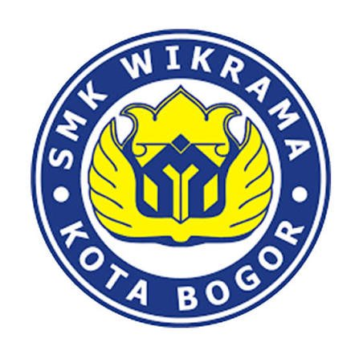

# LUMEN — Luminous Energy Management
> **Kampanye Konservasi Energi Listrik di Lingkungan SMK Wikrama Bogor**  
> *"Satu Kebiasaan, Sejuta Penghematan."*



[](https://smkwikrama.sch.id)
[](#)
[](#)
[](#)
[-darkgreen?style=flat-square)](#)

---

## 📌 Daftar Isi
- [Ringkasan Proyek](#-ringkasan-proyek)
- [Latar Belakang & Karakter Wikrama](#-latar-belakang--karakter-wikrama)
- [Fitur Utama](#-fitur-utama)
- [Integrasi Lintas Mata Pelajaran](#-integrasi-lintas-mata-pelajaran)
- [Teknologi yang Digunakan](#-teknologi-yang-digunakan)
- [Struktur Direktori](#-struktur-direktori)
- [Panduan Memulai (Local Setup)](#-panduan-memulai-local-setup)
- [Prinsip Desain & Standar Tampilan](#-prinsip-desain--standar-tampilan)
- [Roadmap Pengembangan](#-roadmap-pengembangan)
- [Tim Pengembang](#-tim-pengembang)

---

## 📖 Ringkasan Proyek

**LUMEN (Luminous Energy Management)** adalah website kampanye edukatif berbasis web yang dirancang untuk membangun kesadaran dan kebiasaan konservasi energi listrik di lingkungan **SMK Wikrama Bogor**.

Proyek ini dibangun oleh **Kelompok 7 Kelas PPLG XI-4** sebagai wujud nyata pengamalan karakter **Sekolah Adiwiyata Mandiri** dan penerapan standar **5R K3LH** di laboratorium kejuruan. Melalui pendekatan visual yang bersih, interaktif, dan mudah dipahami, LUMEN mengajak seluruh warga sekolah menerapkan budaya **3M Listrik (Mematikan, Mencabut, Mengatur)**.

---

## 🏫 Latar Belakang & Karakter Wikrama

SMK Wikrama Bogor memegang moto kehormatan:  
> *"Ilmu yang Amaliah, Amal yang Ilmiah, Akhlakul Karimah"*

Sebagai sekolah pelopor *Green School* dan peraih predikat **Adiwiyata Mandiri**, kepedulian lingkungan bukan sekadar wacana teoretis, melainkan karakter harian. 

Dengan ribuan siswa dan puluhan laboratorium komputer aktif (khususnya konsentrasi keahlian PPLG dan TJKT), konsumsi listrik sekolah sangat intensif. Potensi pemborosan sering timbul dari hal-hal kecil:
1. **Lampu & Kipas Ruang Kelas** dibiarkan menyala saat jam istirahat, salat berjamaah, atau kegiatan luar ruangan.
2. **Puluhan Komputer Laboratorium** tetap menyala (*standby mode*) setelah sesi praktikum coding selesai.
3. **Pendingin Ruangan (AC)** disetel pada suhu ekstrem (18°C) saat ventilasi terbuka atau cuaca sejuk.

LUMEN hadir menjawab tantangan ini dengan pendekatan persuasif, menyajikan simulasi nyata perbandingan beban listrik, serta pelacak komitmen aksi langsung.

---

## ✨ Fitur Utama

### 1. Hero Section & Simulator Ruang Belajar Wikrama
- Simulasi interaktif saklar listrik ruang belajar dan lab.
- Memungkinkan pengguna beralih antara kondisi **Beban Penuh** (boros energi) dan **Mode Hemat Aktif** (3M diterapkan).
- Memberikan feedback visual instan pada status lampu, komputer lab, dan pendingin ruangan.

### 2. Narasi & Pilar Karakter Adiwiyata
- Pengenalan budaya ramah lingkungan sekolah.
- Menghubungkan kepedulian energi dengan tanggung jawab moral warga sekolah.

### 3. Panduan Aksi Nyata 3M Wikrama
- **Mematikan:** Mematikan saklar lampu dan kipas angin saat meninggalkan ruangan.
- **Mencabut:** Mencabut steker charger dan mematikan stop kontak komputer lab usai jam praktikum.
- **Mengatur:** Menjaga termostat pendingin ruangan pada suhu efisien 24°C–25°C.

### 4. Pelacak Komitmen Aksi Siswa (Interactive Tracker)
- Checklist komitmen aksi 3M harian.
- Progress bar persentase dinamis dengan indikator warna status.
- Pesan umpan balik kontekstual berdasarkan jumlah aksi yang dipilih.

### 5. Teaser Data & Fakta Sekolah (Persiapan Fase 2)
- Kartu statistik fakta konsumsi listrik sekolah.
- Informasi awal mengenai observasi kampus dan persiapan integrasi grafik Chart.js di Fase 2.

### 6. Aksesibilitas & Responsivitas Penuh
- Dukungan navigasi mobile dengan menu drawer yang ramah sentuhan.
- Aksesibilitas keyboard (dapat menutup menu mobile menggunakan tombol `Escape`).
- Kontras warna teks memenuhi standar **WCAG AA** (> 5:1).

---

## 📚 Integrasi Lintas Mata Pelajaran

Proyek LUMEN merupakan hasil kolaborasi pembelajaran berbasis proyek (*Project-Based Learning*) lintas disiplin ilmu:

| Mata Pelajaran | Integrasi dalam Proyek LUMEN |
|---|---|
| **PPLG** | Arsitektur web bersih, HTML5 semantik, CSS modular berbasis variabel desain, dan JavaScript murni tanpa ketergantungan library luar. |
| **PABP** | Internalisasi nilai amanah menjaga alam semesta dan larangan perilaku mubazir (pemborosan energi). |
| **Matematika** | Formulasi kalkulasi daya listrik (Watt ke kWh), kalkulasi persentase pada progress bar komitmen, dan analisis angket riset sekolah. |
| **Bahasa Indonesia** | Penyusunan copy teks kampanye yang persuasif, komunikatif, runtut, santun, dan bebas dari gaya bahasa generik. |
| **Pendidikan Pancasila** | Penanaman nilai gotong royong, disiplin warga sekolah, dan tanggung jawab sosial bersama. |
| **KIK** | Analisis efisiensi pemanfaatan sumber daya dan efisiensi biaya operasional sarana sekolah. |

---

## 🛠️ Teknologi yang Digunakan

- **Markup:** HTML5 Semantik (bebas tag usang, ramah screen-reader)
- **Styling:** Vanilla CSS3 (tanpa framework, menggunakan CSS Custom Properties / Tokens)
- **Scripting:** Vanilla JavaScript (ES6+, modular, tanpa jQuery/library berat)
- **Font:** Google Fonts — *Plus Jakarta Sans*
- **Aset Visual:** Format SVG ringan & logo resmi SMK Wikrama Bogor

---

## 📂 Struktur Direktori

```text
LUMEN/
├── assets/
│   ├── wikrama/                 # Foto dokumentasi resmi SMK Wikrama Bogor
│   │   ├── gedung-kampus.jpg    # Gedung sekolah & kampus hijau Adiwiyata
│   │   ├── ruang-kelas.png      # Suasana ruang kelas pembelajaran
│   │   ├── lab-komputer.jpg     # Fasilitas laboratorium komputer & SOC
│   │   ├── perpustakaan.png     # Perpustakaan & fasilitas belajar bersama
│   │   └── aktivitas-3.png      # Dokumentasi siswa-siswi SMK Wikrama
│   ├── hero-illustration.svg    # Ilustrasi utama bagian hero
│   ├── icon-ac.svg              # Ikon pendingin ruangan
│   ├── icon-bulb.svg            # Ikon lampu hemat energi
│   ├── icon-computer.svg        # Ikon komputer laboratorium
│   ├── icon-leaf.svg            # Ikon daun Adiwiyata
│   ├── icon-plug.svg            # Ikon steker listrik
│   ├── icon-switch.svg          # Ikon saklar hemat listrik
│   ├── logo.svg                 # Vektor logo LUMEN
│   └── logo-wikrama.jpg         # Logo resmi SMK Wikrama Bogor
├── css/
│   └── style.css                # Seluruh rancangan gaya, layout responsif, & tema
├── js/
│   └── script.js                # Interaktivitas simulator, checklist komitmen, navbar, & scroll spy
├── index.html                   # Halaman utama landing page kampanye
├── PRD.md                       # Product Requirement Document
├── DESIGN.md                    # Panduan identitas visual & tokens sistem desain
├── AGENTS.md                    # Konfigurasi panduan coding agent
└── README.md                    # Dokumentasi lengkap proyek (file ini)
```

---

## 🚀 Panduan Memulai (Local Setup)

Proyek ini dibangun menggunakan teknologi web murni (*zero dependency*), sehingga dapat dijalankan langsung di lingkungan lokal tanpa perlu instalasi `npm` atau kompilasi build tools.

### Cara 1: Menggunakan Live Server di VS Code (Sangat Direkomendasikan)
1. Buka folder `LUMEN` di **Visual Studio Code**.
2. Pastikan ekstensi **Live Server** (oleh Ritwick Dey) sudah terpasang.
3. Klik kanan pada file `index.html`, lalu pilih **Open with Live Server** (atau gunakan shortcut `Alt + L, Alt + O`).
4. Halaman akan terbuka secara otomatis di peramban pada alamat `http://127.0.0.1:5500`.

### Cara 2: Menggunakan Python HTTP Server
Jika memiliki Python di komputer Anda:
```bash
# Masuk ke direktori proyek
cd "LUMEN"

# Jalankan web server lokal
python -m http.server 8000
```
Buka browser dan akses alamat [http://localhost:8000](http://localhost:8000).

### Cara 3: Langsung Buka File HTML
Cukup klik ganda (*double-click*) file `index.html` pada File Explorer untuk membukanya langsung di browser favorit Anda.

---

## 🎨 Prinsip Desain & Standar Tampilan

LUMEN menerapkan prinsip desain terkurasi untuk memastikan antarmuka terasa **dibuat secara profesional oleh desainer**, bukan template generik AI:

1. **Warna Alami & Identitas Adiwiyata**:
   - `Forest Deep Green` (`#1E4635`): Melambangkan kelestarian alam dan karakter Adiwiyata.
   - `Amber Listrik` (`#C25E00`): Melambangkan energi dan aksen tindakan.
   - `Latar Bersih` (`#FFFFFF` & `#F7F9F7`): Memberikan ruang baca yang tenang dan elegan.
2. **Kesesuaian Tipografi**: Menggunakan jenis huruf *Plus Jakarta Sans* dengan hierarki skala visual yang proporsional.
3. **Tanpa Dekorasi Berlebih**: Menghindari elemen visual yang tidak memiliki fungsi struktural (tanpa gradient acak, tanpa penumpukan SVG berlebihan, dan tanpa emoji berulang).

---

## 🗺️ Roadmap Pengembangan

| Fase | Ruang Lingkup | Status |
|---|---|---|
| **Fase 1** | Pondasi web, landing page edukasi, layout responsif, simulator ruang belajar interaktif, checklist komitmen 3M, dan dokumentasi lengkap. | **Selesai** |
| **Fase 2** | Integrasi visualisasi grafik Chart.js (CDN & offline fallback) dari data 636 responden siswa kelas XI lintas 7 jurusan via `data-perilaku-energi.json`, 4 kartu statistik KPI, dan analisis temuan kunci. | **Selesai** |
| **Fase 3** | Kalkulator estimasi penghematan kWh & rupiah, leaderboard partisipasi kelas, dan integrasi fitur lanjutan. | *Tahap Berikutnya* |

---

## 👥 Tim Pengembang

Proyek ini dikembangkan oleh:
* **Tim**: Kelompok 7
* **Kelas**: PPLG XI-4 (Pengembangan Perangkat Lunak dan Gim)
* **Institusi**: SMK Wikrama Kota Bogor
* **Tahun Ajaran**: 2026

---
*LUMEN — Satu Kebiasaan, Sejuta Penghematan. Wujudkan Karakter Adiwiyata Mandiri SMK Wikrama Bogor.*

